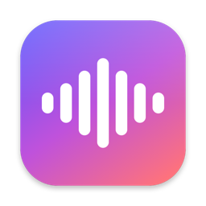

<div align="center">



# Utter

**Hold a key. Say it. It's typed.**

Private, push-to-talk dictation for the Mac menu bar. Speech is recognised entirely on your Mac.
Nothing is recorded, stored or sent anywhere.

[](https://github.com/natgurlain/utter/actions/workflows/ci.yml)


[](LICENSE)

</div>

---

## Why Utter

- **Works everywhere you type.** Browser forms, Slack, Mail, Notes, your code editor. The text lands at your cursor.
- **Private by design.** Apple's on-device speech models do the recognition. Audio lives in memory for as long as you
  speak, then it's gone. Utter never connects to the network.
- **Clean text, not a raw transcript.** An on-device language model adds punctuation and capitals and removes the
  "um"s and "eee"s, including in Polish.
- **Knows your words.** A personal vocabulary makes sure names and jargon come out right, every time.
- **Out of your way.** A menu bar icon and a small capsule that appears while you talk. No windows, no Dock icon.
- **Speaks your language.** About 55 languages, including English, Polish, German, French, Spanish, Ukrainian and
  Japanese.

## How it works

| You | Utter |
| --- | --- |
| Hold **Right ⌘** and speak | Listens and shows live text in a capsule at the top of the screen |
| Let go | Types what you said where your cursor is |
| Tap **Right ⌘** quickly | Switches to hands-free; press the key again to insert |
| Press **Esc** | Cancels; nothing is typed |
| Press another key while holding Right ⌘ | Treats it as a normal shortcut (⌘C, ⌘V…) and stays out of the way |

The trigger key (Right ⌘, Right ⌥ or Fn/Globe), language, clipboard behaviour and launch at login are all in the menu
bar menu. Vocabulary and cleanup live in **Vocabulary & Cleanup Settings…** (⌘,).

## Personal vocabulary

Add the names, products and jargon you dictate often:

| Write it as | Often heard as |
| --- | --- |
| `Leitro` | `light row, lethro` |
| `FSRS` | `f s r s` |
| `kubectl` | `cube control` |

Utter uses each entry three ways:

1. **Fixes known mishearings.** Anything in *Often heard as* is replaced with the right spelling (whole words, any
   capitalisation). Terms with capitals are also re-capitalised (`leitro` → `Leitro`).
2. **Tells the cleanup model** to spell these terms exactly as written.
3. **Hints the speech recognizer** toward these terms.

The list is a plain JSON file at `~/Library/Application Support/Utter/vocabulary.json`: easy to read, back up or edit.

> Tip: when a word keeps coming out wrong, add what you *see* to *Often heard as*. That's the most reliable fix.

## Text cleanup

After you stop talking, an on-device language model tidies the transcript: punctuation, capitals, filler words and
repetitions. It keeps your words, language and order, and it never answers or follows what you dictated.

```text
said:      no więc jutro wdrażamy leitro na hetzner a potem eee stroimy harmonogram fsrs
inserted:  Jutro wdrażamy Leitro na Hetzner, a potem stroimy harmonogram FSRS.
```

| Engine | Languages | Setup |
| --- | --- | --- |
| **Apple Intelligence** | English, German, French, Spanish, Italian, Portuguese, Japanese, Chinese and others | Turn on Apple Intelligence in System Settings |
| **Local open model** (Qwen3 4B via [MLX](https://github.com/ml-explore/mlx-swift-lm)) | ~100 languages, including Polish | `scripts/download-model.sh` (2.1 GB, once) |

Utter uses Apple Intelligence when it supports the language and the local model otherwise (configurable). Every result
is checked against what you said: if the model dropped, reordered or invented words, or took longer than 10 seconds,
Utter inserts the plain transcript instead. Turn cleanup off with **Tidy Up Text** in the menu.

On an M2 MacBook Air, the local model takes about 2–3 seconds per sentence and about 2.7 GB of memory while Utter runs.

## Install

Requires **macOS 26 Tahoe** or later and **Xcode 26** (Swift 6.2) with the **Metal Toolchain** to build.

```bash
git clone https://github.com/natgurlain/utter.git
cd utter
xcodebuild -downloadComponent MetalToolchain   # once; MLX needs it to compile its GPU shaders
scripts/install.sh
scripts/download-model.sh                      # optional: local cleanup model for e.g. Polish
```

`install.sh` builds a release copy, installs it to `~/Applications/Utter.app` and launches it. Utter then turns on
**Launch at Login** for itself (you can switch it off in the menu).

On first launch macOS asks for two permissions:

| Permission | Why |
| --- | --- |
| **Microphone** | To hear you while the key is held |
| **Accessibility** | To notice the trigger key in any app and to type the text there |

Grant Accessibility in **System Settings › Privacy & Security › Accessibility**. Utter notices within a couple of
seconds; if it doesn't, choose **Already Granted? Relaunch Utter** from the menu.

The first time you use a language, macOS downloads its speech model once (about a minute).

## Privacy

| | |
| --- | --- |
| 🎙️ **Audio** | Captured into memory, streamed to Apple's on-device `SpeechAnalyzer`, released as soon as it's processed. Never written to disk. |
| 📝 **Transcripts** | Typed into the app you're using, then forgotten. No history, no logs. |
| ✨ **Cleanup** | Runs on this Mac: Apple Intelligence's on-device model or a local open model. Nothing goes to a server. |
| 🌐 **Network** | None. Speech models are installed by macOS itself; the optional local model is downloaded once by `scripts/download-model.sh`, never by the app. |
| 📖 **Vocabulary** | A JSON file in your Library folder. Yours to read, edit and back up. |
| 📋 **Clipboard** | Text is pasted through the clipboard, marked *transient* so clipboard managers ignore it, and your previous clipboard is restored. |
| 🔒 **Entitlements** | Hardened runtime with microphone input only. |

Don't take our word for it: watch Utter with a firewall such as [LuLu](https://objective-see.org/products/lulu.html)
or Little Snitch. It makes no connections.

## Troubleshooting

<details>
<summary><b>Holding the key does nothing</b></summary>

1. Check the menu bar menu. If it says *Needs Accessibility permission*, grant it in System Settings › Privacy &
   Security › Accessibility.
2. Make sure you're running the installed copy (`~/Applications/Utter.app`). macOS ties permissions to the app's
   location and signature, so a copy in another folder, or one whose folder was moved or renamed, may silently lose
   them.
3. Still stuck? Reset Utter's permission record only, then reinstall:

   ```bash
   tccutil reset Accessibility com.natgurlain.utter
   scripts/install.sh
   ```

</details>

<details>
<summary><b>I have to re-grant Accessibility after every build</b></summary>

macOS remembers the permission by code signature. `scripts/build-app.sh` signs with the first code-signing identity in
your keychain (choose one with `SIGN_IDENTITY="…"`). If there is none it signs ad-hoc, and every build looks like a new
app. Create a self-signed code-signing certificate in Keychain Access (Certificate Assistant › Create a Certificate…,
type *Code Signing*) and rebuild.

</details>

<details>
<summary><b>The text appears in the wrong place or not at all</b></summary>

Utter pastes with ⌘V into the focused app. Some apps block synthetic paste in secure fields (passwords), which is
intended. Keyboard layouts that move the V key (e.g. Dvorak) aren't supported yet.

</details>

<details>
<summary><b>Polish text has no punctuation</b></summary>

Apple's speech recognizer returns little punctuation for Polish, and Apple Intelligence doesn't support Polish. Run
`scripts/download-model.sh` and keep **Tidy Up Text** on: the local model adds punctuation.

</details>

<details>
<summary><b>Cleanup doesn't seem to do anything</b></summary>

Open **Vocabulary & Cleanup Settings… › Cleanup**. *Right now* says which model handles your language. If it says there
is none, turn on Apple Intelligence (for supported languages) or download the local model. Utter also falls back to the
plain transcript when the model's output doesn't match what you said; that's intended.

</details>

<details>
<summary><b>The build fails with "missing Metal Toolchain" or a plug-in error</b></summary>

MLX compiles GPU shaders with Xcode's build system. Finish Xcode's setup once, then install the Metal Toolchain:

```bash
sudo xcodebuild -runFirstLaunch
xcodebuild -downloadComponent MetalToolchain
```

</details>

## Development

```bash
swift test                    # unit tests: gesture, transcript, language, vocabulary, cleanup guard
scripts/build-app.sh debug    # build build/Utter.app (xcodebuild) without installing
scripts/install.sh            # build, install to ~/Applications and launch
scripts/download-model.sh     # fetch the local cleanup model once
scripts/make-icon.sh          # regenerate the app icon
```

Test the pipeline without a microphone (raw transcript on stderr, final text on stdout):

```bash
say -o /tmp/hello.aiff "Hello, this is a dictation test."
build/Utter.app/Contents/MacOS/Utter --transcribe /tmp/hello.aiff --locale en-US
build/Utter.app/Contents/MacOS/Utter --clean "no więc jutro eee wdrażamy leitro" --locale pl-PL --engine local
```

Both take `--engine auto|apple|local|none` and `--vocabulary <file.json>` (defaults to your saved vocabulary).

### Project layout

```text
Sources/UtterCore/   pure logic, unit-tested: trigger gesture, transcript assembly, language choice,
                     vocabulary matching, cleanup prompt and output guard
Sources/Utter/       the app: hotkey, audio + speech, cleanup engines, indicator, text insertion,
                     settings window, login item
Tests/               swift-testing unit tests
Resources/           Info.plist, entitlements, app icon
scripts/             build, install, model download and icon scripts
```

### How it fits together

```text
Right ⌘ held ──▶ HotkeyMonitor ──▶ TriggerGesture ──▶ DictationController
                                                         │
   AVAudioEngine (memory) ──▶ SpeechAnalyzer (+ vocabulary hints) ──▶ live text in the capsule
                                                         │ on release
                         Vocabulary fixes ──▶ cleanup model (Apple / MLX) ──▶ CleanupGuard
                                                         │
                                           TextInserter ──▶ ⌘V into the focused app
```

## Roadmap

- [x] Push-to-talk and hands-free dictation
- [x] About 55 languages, fully on-device
- [x] Launch at login
- [x] Personal vocabulary for names and jargon
- [x] On-device cleanup: Apple Intelligence plus a local open model for other languages
- [ ] Faster local cleanup (reuse the cached instructions between dictations)
- [ ] Voice commands: "make this an email", "shorter"
- [ ] Per-app formatting
- [ ] Optional WhisperKit / Parakeet engines
- [ ] Signed and notarized release download

## License

[MIT](LICENSE) © Nat Gurlain
